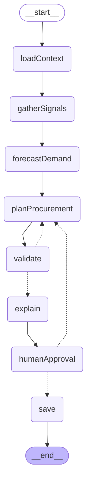

<div align="center">


&nbsp;

&nbsp;


<br /><br />

# 🧠 Bazaar Brain

### *रोज़ का हिसाब, AI का जवाब*
*Daily stock decisions, answered by AI*

**An agentic AI demand forecasting tool for street vendors in Hazratganj, Lucknow —**  
combining live weather, local events, and custom inventory to deliver daily procurement recommendations.

[**View Live Demo →**](https://stall-brain.vercel.app)

</div>

---

## 👥 Team Code Oxide

| Name | GitHub |
|------|--------|
| Tushar Bajpai | [@Tushar](https://github.com/Tushar-Bajpai) |
| Sankalp Saini | [@Sankalp](https://github.com/Arikalp) |
| Subrat Dwivedi | [@Subrat](https://github.com/subrat-dwi) |
| Utsav Singh | [@Utsav](https://github.com/githubutsav) |

**Repository:** [github.com/subrat-dwi/stall-brain](https://github.com/subrat-dwi/stall-brain)

---

## 🎯 Problem Statement 

> *"Hazratganj's iconic street market has vendors who over-stock or under-stock daily, leading to waste and lost revenue. Build an agent that reads footfall patterns, weather, local events, and social buzz to recommend optimal daily procurement."*
>
> **Lucknow context:** Hazratganj · Janpath Market

Every morning, thousands of street vendors in Hazratganj make the same high-stakes guess: **how much stock should I buy today?**

They have no tools. They rely on gut feel, last week's memory, and WhatsApp forwards. The consequences are real:

- A vendor overbought potatoes on a rainy day — the crowd never came, the stock rotted.
- The next day, fearing rain again, he bought less — but it was an LSG match day, the streets were packed, and he sold out by 4 PM, losing thousands in revenue.

This isn't bad luck. It's a **data problem**. The signals exist — weather forecasts, event calendars, day-of-week patterns — but no one has put them together for a Hazratganj vendor. Bazaar Brain does exactly that.

---

## 💡 Solution

Bazaar Brain is a **multi-page agentic web app** that acts as a daily procurement advisor for street vendors. A vendor picks their stall type, customizes their item list, and the AI agent synthesizes live weather data, a Lucknow-specific event calendar, and weekly footfall patterns to produce a precise, actionable stock recommendation — in English and Hindi.

The AI doesn't just answer a prompt. It **reasons across multiple data signals** before generating output, making it genuinely agentic rather than a simple chatbot.

---

## ✨ Features

**Vendor Auth & Persistent Profiles**
Users sign up, log in, and keep their stall profile saved across sessions.

**Stall Type Selection (7 types)**
Seven vendor archetypes tailored to Hazratganj: Chaat, Chai, Juice, Flowers, Bhutta, Snacks & Namkeen, Balloon & Toy.

**Editable Ingredient Lists**
Profile ingredients are fully editable: add, remove, or rename items before saving.

**Current Inventory Input**
Vendors enter what they already have per item (quantity + unit), so the AI recommends only what to buy today.

**Live Lucknow Weather (Open-Meteo)**
Real-time weather for Hazratganj coordinates drives footfall impact multipliers.

**Lucknow Event Radar**
Local events and weekly patterns feed the demand calculation before the AI prompt is built.

**Demand Multiplier Engine**
The system computes:

```
Demand Multiplier = Weather Impact × Event Impact × Day-of-Week Pattern
```

**Smart Procurement Output**
Each item returns Total Needed, You Have, and Buy Today with priorities and notes.

**Bilingual Output (EN + HI)**
Forecasts include English and Hindi summaries with a one-click toggle.

**Forecast History & Feedback Loop**
Runs are stored locally with feedback and inventory snapshots for future reference.

---

## 🗺️ App Flow

```
Landing  →  Profile Setup  →  Forecast Page  →  AI Output
(welcome)    (stall +          (inventory +       (buy today
			 ingredients)       session edits)    breakdown)
```

Your stall profile saves permanently. Each forecast lets you make temporary adjustments — add a seasonal item, remove something you're skipping today — without touching your saved profile.

---

## 🛠️ Tech Stack

| Layer | Technology |
|---|---|
| Frontend | React 19 + Vite |
| Styling | Tailwind CSS v4 + CSS Variables |
| Auth | Firebase (signup / login / session) |
| Routing | React Router v6 |
| AI / LLM | Groq API — `openai/gpt-oss-120b`, called server-side via LangGraph.js |
| Weather | Open-Meteo API (free, no key required) |
| Icons | Lucide React |
| Storage | Firebase (auth + Firestore vendor data) + localStorage (forecast history, session) |
| Deployment | Vercel |

Coding Agent used : Copilot with GPT Codex


## 🏗️ Architecture

High-level: Client SPA → Signal Engine → Agent → LLM → UI & Storage

File structure:

```
src/
	pages/
		LandingPage.jsx
		ProfilePage.jsx
		ForecastPage.jsx
	components/
		Header.jsx
		StallSelector.jsx
		IngredientEditor.jsx
		InventoryInput.jsx
		SignalPanel.jsx
		LoadingState.jsx
		PlanEditor.jsx
		ForecastOutput.jsx
		FeedbackBar.jsx
		HistoryLog.jsx
	utils/
		groqAgent.js
		weatherLogic.js
		selectionStorage.js
	data/
		stalls.js
		events.js

backend/
	src/
		index.js               # Express bootstrap (CORS, helmet, rate limit)
		routes/forecast.js     # /api/forecast, /resume, /stream (SSE)
		graph/                 # LangGraph.js agent (see diagram below)
		tools/                 # Live signal tools (weather, events, cricket, prices)
		store/                 # Firestore vendor context + checkpoint saver
		schemas.js             # Zod contracts (every LLM output is validated)
	tests/                     # Vitest suites (109 tests)
	scripts/                   # Live smoke tests (smoke-graph, smoke-degraded)
```

Data contracts:

```
UserProfile = {
	stallType,
	stallLabel,
	stallEmoji,
	ingredients[]
}

ForecastSession = {
	sessionIngredients[],
	inventory: { [item]: { quantity, unit } }
}

DemandMultiplier = {
	weather,
	event,
	weekday,
	combined
}

ProcurementItem = {
	item,
	totalNeeded,
	alreadyHave,
	toBuy,
	unit,
	priority,
	note
}

ForecastResult = {
	summary,
	hindiSummary,
	expectedCustomers,
	peakHours,
	confidenceLevel,
	confidenceReason,
	procurementList[],
	sufficientStockItems[],
	specialAdvice
}
```

### Agent graph (LangGraph.js)

The backend runs the forecast as a LangGraph.js agent (`backend/src/graph/`). Two dashed edges:
- `validate → planProcurement` is the **self-correction loop**: a code-based validator rejects bad plans and sends them back to the planner (max 3 retries, then falls back to the deterministic draft).
- `humanApproval → planProcurement` is the **vendor rejection loop**: the vendor can reject a plan up to 3 times to have it regenerated; `humanApproval` is an interrupt — the graph pauses there until the vendor approves (optionally with edited quantities) via `POST /api/forecast/resume`.

Generated with `graph.getGraph().drawMermaid()` (regenerate: `node backend/scripts/dump-mermaid.mjs`).




---

## 🚀 Running Locally

**1. Clone the repository**
```bash
git clone https://github.com/placeholder/bazaar-brain.git
cd bazaar-brain
```

**2. Add your Groq API key (backend only)**

The LLM key lives only on the server — the browser never sees it. Create a `.env` file in `backend/` (see `backend/.env.example`):
```
GROQ_API_KEY=your_groq_api_key_here
```
Get a free key at [console.groq.com](https://console.groq.com/) — no credit card needed.

**3. Install and run**
```bash
npm install
cd backend && npm install && npm run dev   # Express API on :3001
cd .. && npm run dev                       # Vite frontend on :5173
```

Open [http://localhost:5173](http://localhost:5173).

---

## 🔭 What's Next

- **WhatsApp delivery** — send the daily forecast directly to a vendor's phone each morning
- **Crowdsourced social signals** — parse local hashtags like `#Hazratganj` and `#LucknowFoodies` to catch viral footfall spikes
- **Group buying** — aggregate demand across nearby vendors to unlock wholesale pricing on shared items
- **Revenue estimator** — vendor inputs selling price per item; app calculates expected daily earnings vs procurement cost

---

<div align="center">

Built with 💛 for the street vendors of Hazratganj, Lucknow.

*APL Hackathon 2026*

</div>
